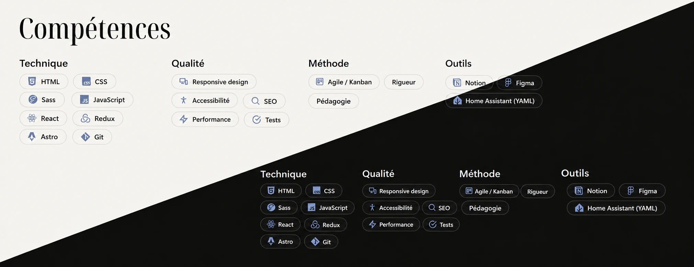
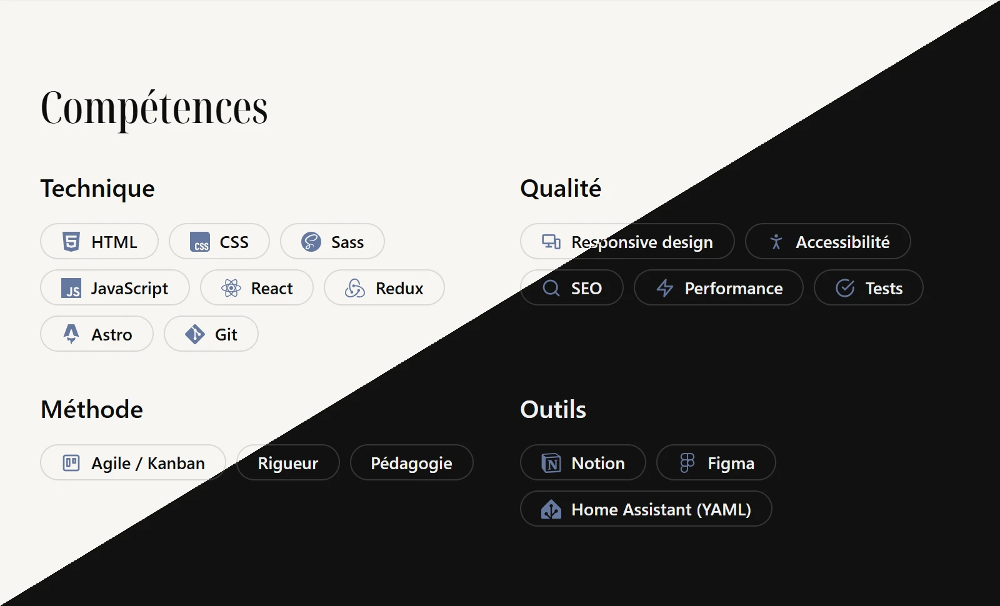
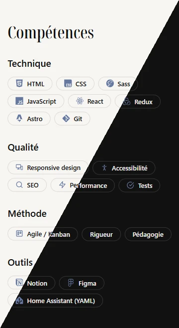

## Contexte

Dernier projet de ma formation Intégrateur Web : réaliser et publier mon portfolio. C'est aussi mon site vitrine de Développeur freelance. Il s'adresse à deux publics : les recruteurs et mes futurs clients.

## Objectifs

- Présenter mon parcours, mes compétences et mes projets de formation.
- Publier un site statique responsive, accessible et bien référencé.
- Organiser le travail en tâches et en sprints, dans un Kanban.

## Stack technique

- Astro (site statique), avec un îlot React pour la galerie filtrable.
- Sass (variables, mixins) et variables CSS pour les thèmes clair et sombre.
- Contenus en Markdown, vérifiés par un schéma au build.
- GitHub Pages, avec un déploiement continu par GitHub Actions.

## Compétences développées

- Apprentissage d'un nouveau framework, choisi en comparant trois approches : un site en HTML, Sass et JavaScript natifs, une application React, et Astro avec un îlot React.
- Architecture en îlots : le HTML est généré au build, et React n'est chargé que lorsque la galerie devient visible.
- Accessibilité vérifiée par des outils automatisés (Lighthouse, axe DevTools, WAVE), complétés de tests manuels : clavier, zoom à 200 %, lecteur d'écran.
- Référencement : balises propres à chaque page, données structurées, sitemap, Search Console.

## Design system

Couleurs aux contrastes vérifiés, typographie, espacements et composants sont définis une seule fois, puis réutilisés dans tout le site. Chaque section s'adapte à trois paliers, dans les deux thèmes.

_La section Compétences sur ordinateur, tablette et mobile, en thème clair et sombre._

## Résultats et impact

- Une page d'accueil en sept sections, dont six accessibles depuis le menu, et une fiche générée pour chaque projet : ajouter un projet revient à ajouter un fichier.
- Lighthouse, site en ligne : performance 100 sur ordinateur et 98 à 99 sur mobile ; accessibilité, bonnes pratiques et SEO à 100.
- Aucune requête vers un domaine extérieur : la police est hébergée sur le site.
- Le projet est validé sans axe d'amélioration. L'évaluateur souligne une architecture cohérente et un code très propre.

## Perspectives d'amélioration

- Passer au domaine pollastri.fr, chez un hébergeur qui permet de régler la durée du cache.
- Ajouter un formulaire de contact accessible.
- Écrire des tests unitaires pour la galerie filtrable.
